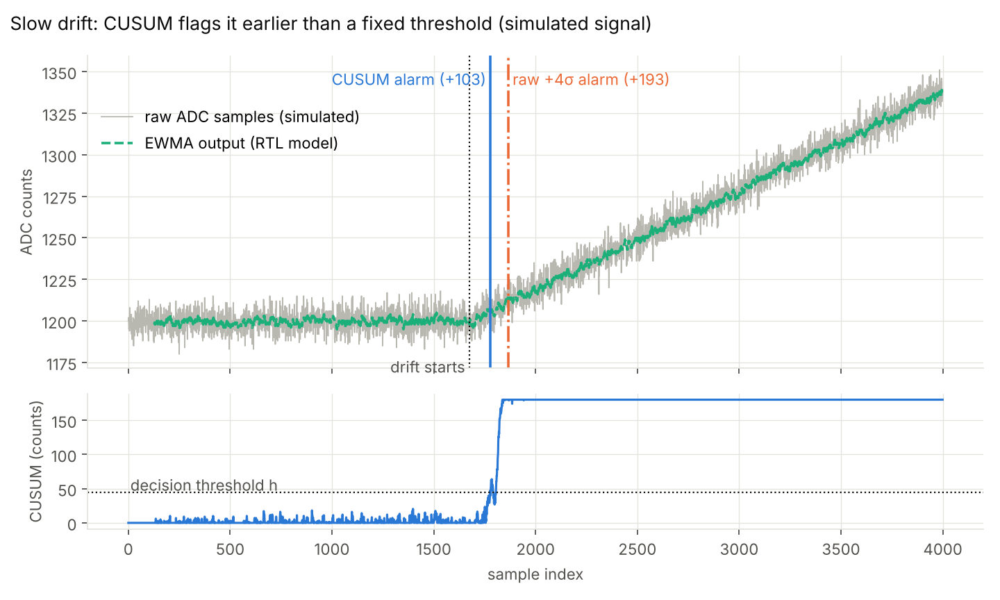
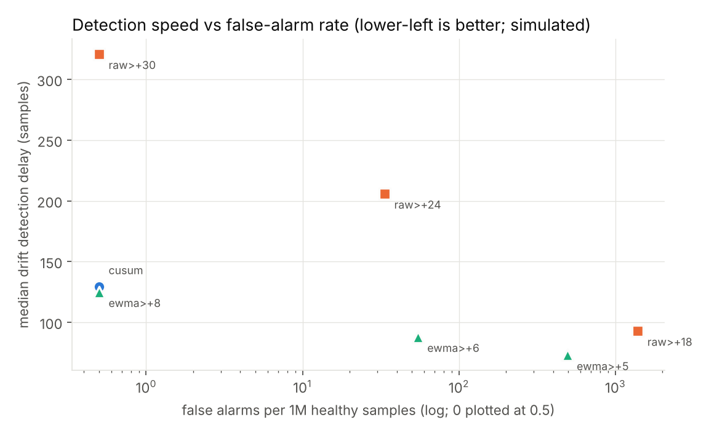

# edge-monitor-fpga

A small, reusable **FPGA brick for sensor condition monitoring**: it reads a sensor through an SPI ADC, detects slow drift or step changes in hardware, and reports over UART, sending a few bytes per second instead of streaming every sample.

Written in **VHDL-2008 and SystemVerilog** (mixed-language), verified bit-exactly against a Python reference model, synthesised and placed-and-routed for Lattice iCE40 with the open-source toolchain (Yosys, GHDL, Verilator, nextpnr).

> **Scope, stated plainly.** Everything below comes from **simulation and synthesis**. The brick has **not** been run on a physical board, and all sensor signals are **synthetic** (Gaussian noise plus an injected ramp or step). Numbers labelled *simulated* are measured on that synthetic data; they are not field results.

## Architecture

```
SPI ADC -> spi_master (SV) -> ewma_cusum (VHDL) -> packetizer (SV) -> byte_fifo (SV) -> uart_tx (VHDL) -> host
                                    |
                                    +-> alarm_led
```

| Block | Language | What it does |
|---|---|---|
| `spi_master` | SystemVerilog | SPI mode 0, 16-bit frame, 12-bit sample; 4 SystemVerilog assertions (SVA) check the protocol live in simulation |
| `ewma_cusum` | VHDL-2008 | Calibrates a baseline (mean of 128 samples), then runs an EWMA (alpha = 1/8) and a two-sided CUSUM, all in fixed point (4 fractional bits); saturating registers |
| `packetizer` | SystemVerilog | `RAW=1`: `A5 hi lo` per sample. `RAW=0`: an event packet `C7 ...` on each rising alarm plus a summary packet `B6 ...` every 64 samples |
| `byte_fifo` | SystemVerilog | 16-deep first-word-fall-through FIFO with sticky overflow flag |
| `uart_tx` | VHDL-2008 | 8N1 transmitter, valid/ready handshake, `CLKS_PER_BIT` generic |

The two VHDL blocks are instantiated from SystemVerilog and synthesised together through the Yosys GHDL plugin.

## Verification (layered)

| Level | Tool | Result |
|---|---|---|
| Drift core vs Python integer model | GHDL | 12,900 vectors, **0 mismatches** (includes saturation cases at 0 and 4095) |
| UART transmitter | GHDL | 200 random bytes, bit period and stop bit checked |
| SPI master | Verilator + SVA | 3,000 frames, 0 errors, assertions live |
| Assertion check (mutation) | Verilator | An injected bug (wrong idle clock level) **is caught** by the assertions, so they are not vacuous |
| Whole brick (SPI to UART) | Verilator on the **Yosys-synthesised mixed VHDL+SV netlist** | UART byte stream **identical to the Python model**, event mode (1,236 bytes) and raw mode (38,700 bytes), no FIFO overflow |

Open-source simulators cannot run mixed VHDL and SystemVerilog directly, so the integration test runs on the synthesised netlist (post-synthesis functional simulation).

## Results

### Resources and timing (synthesis + place-and-route, iCE40, 12 MHz target, no pin constraints)

| Device | Logic cells used | Block RAM | Fmax (nextpnr) |
|---|---|---|---|
| iCE40 HX8K | 983 / 7,680 (12 %) | 1 / 32 | 38.3 MHz |
| iCE40 UP5K | 983 / 5,280 (18 %) | 1 / 30 | 14.2 MHz |

765 LUT4 + 309 carry cells + 336 flip-flops. Both devices meet the 12 MHz target; on the UP5K the margin is small (14.2 vs 12 MHz). Pins were auto-placed, so timing covers the logic only, not board I/O.

### Detection quality (**simulated**, 2,000,000 healthy samples, 300 drift + 300 step episodes)

Noise sigma = 6 counts; drift slope 0.03 to 0.08 counts/sample; step 15 to 40 counts. Latency is in samples after fault onset. All detectors share the same calibration baseline.

| Detector | False alarms / 1M healthy samples | Drift: median delay (p90) | Step: median delay |
|---|---|---|---|
| **EWMA + CUSUM (this brick)** | **0.5** | **130 (196)** | 2 |
| Raw sample > baseline + 30 | 0.0 | 321 (455) | 1 |
| Raw sample > baseline + 24 (4 sigma) | 33.5 | 206 (311) | 0 |
| Raw sample > baseline + 18 (3 sigma) | 1,391 | 93 (160) | 0 |
| EWMA output > baseline + 8 | 0.5 | 125 (189) | 2 |
| EWMA output > baseline + 6 | 54.5 | 88 (137) | 1 |
| EWMA output > baseline + 5 | 492 | 73 (109) | 1 |

How to read this honestly:

- At a comparable false-alarm rate (about 0 per million), the brick flags slow drift **about 2.5x earlier** than a raw fixed threshold (130 vs 321 samples median).
- A well-tuned **EWMA threshold performs about as well as CUSUM** on this synthetic data (125 vs 130). The CUSUM adds robustness to small persistent shifts without hand-tuning a threshold to the noise level, but on these signals it is not a large win over the EWMA threshold.
- Step faults are caught within a few samples by every detector.
- Thresholds were tuned on simulated data; no real-sensor validation has been done.




### Bandwidth (measured in simulation)

In event mode the brick emits **32x fewer bytes** than raw streaming: 6,000 bytes vs 192,000 bytes per 64,000 healthy samples (31.8x when a drift fault is present). One summary packet is sent every 64 samples; an alarm adds one 6-byte event packet.

### Illustrative value case (assumption-based arithmetic, not a measurement)

Assumptions: 1 kS/s per sensor, 30-day month, payload bytes only (no protocol overhead, no compression).

| Sensors | Raw streaming | Event mode (healthy) |
|---|---|---|
| 1 | 7.8 GB/month | 0.24 GB/month |
| 100 | 0.78 TB/month | 24 GB/month |
| 500 | 3.9 TB/month | 122 GB/month |

Multiply by your own link or storage cost per GB to get a cost figure. Trade-off: in event mode the raw waveform is not available (`RAW` is a compile-time parameter in this version), so a deployment would keep raw mode for commissioning and event mode in service.

## Reproduce

Requires `ghdl`, `yosys` (with the ghdl plugin), `verilator`, `nextpnr-ice40`, Python 3 with `numpy` and `matplotlib`.

```bash
make all          # vectors, all tests, synthesis, place-and-route, analysis + figures
make test-system  # just the whole-brick byte-exact check
make analysis     # just the benchmark (about 6 s)
```

If the ghdl plugin cannot find its libraries: `export GHDL_PREFIX=/usr/lib/ghdl/mcode/vhdl` (path depends on your install; the Makefile sets this default).

## Limitations and next steps

- No board bring-up yet. Natural next step: constrain pins, run on an iCE40 evaluation board with a real SPI ADC and a bench sensor, and replace the synthetic data with a recording.
- Synthetic noise is Gaussian and stationary; real sensors have non-Gaussian noise, seasonality and quantisation.
- One channel only; parameters are generics/constants, not runtime registers.
- The VHDL core computes each sample update in a single clock cycle (this long path sets the Fmax above); at 12 MHz and 1 kS/s there is a large timing margin, but higher sample rates would need a multi-channel/time-multiplexed variant.

## Layout

```
rtl/vhdl   ewma_cusum.vhd, uart_tx.vhd
rtl/sv     spi_master.sv, byte_fifo.sv, packetizer.sv, edge_monitor_top.sv
tb         VHDL and SystemVerilog testbenches (self-checking)
model      Python reference model, signal generators, benchmark
synth      Yosys / nextpnr flow (synth.sh)
results    golden vectors, summary.json, figures
```
